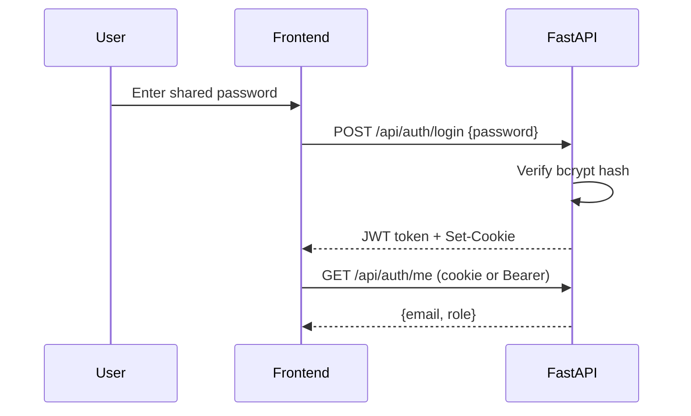
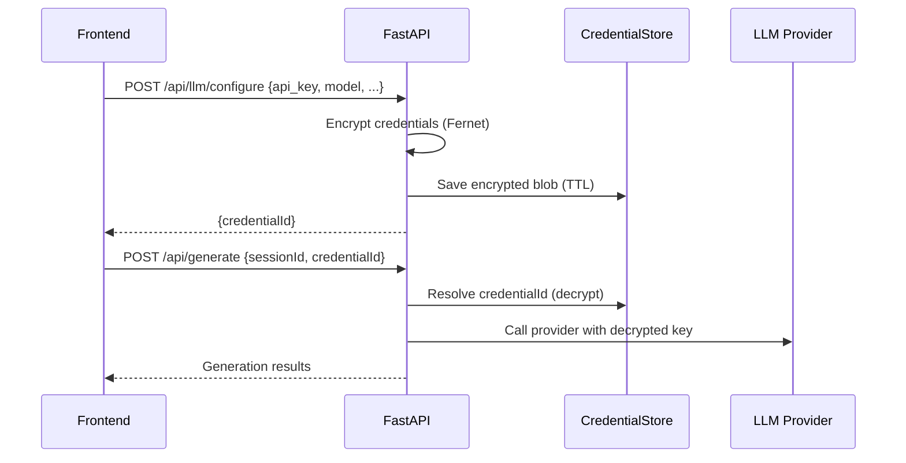

# LLM Keys and Authentication Architecture

## Overview
This service uses shared-password authentication with signed session tokens and rate limiting. LLM credentials can be provided by users (BYOK) via the API and are stored only in memory, encrypted at rest with a server-side Fernet key. Generation jobs refer to an in-memory credential ID, never the raw key.

## Core Components
- Auth API: /api/auth for login, logout, and session validation
- Shared-password auth: bcrypt-verified password, JWT sessions, cookie or Bearer token
- Credential store: in-memory, TTL-backed, encrypted LLM credentials
- LLM config API: /api/llm/* for test, configure, and delete
- Generate API: /api/generate/* uses a credentialId to resolve LLM runtime config

## Authentication Flow (Shared Password)
1. Client posts password to /api/auth/login.
2. Server verifies password hash (user or admin).
3. Server issues a signed JWT session token with exp claim.
4. Token is returned in response and set as an HTTP-only cookie.
5. Protected routes require a valid token via cookie or Bearer header.
6. For cookie-based auth, mutating requests must pass origin checks.
7. All auth endpoints are rate-limited by client IP.

## LLM Key Handling (BYOK)
1. Client submits credentials to /api/llm/test-connection (optional).
2. Client submits credentials to /api/llm/configure.
3. Server encrypts credentials immediately and stores them in memory.
4. Server returns a credentialId (no secrets returned).
5. Client calls /api/generate with sessionId and credentialId.
6. Server decrypts credentials only when creating the LLM runtime config.
7. LLM calls are made with the decrypted key, then the plaintext is discarded.

## Credential Storage Details
- Storage is in-memory only (no disk persistence).
- Entries expire based on CREDENTIAL_TTL_SECONDS.
- Encryption uses a Fernet key from CREDENTIAL_ENCRYPTION_KEY.
- If no key is set, an ephemeral key is generated per process (dev only).

## Security Controls
- Shared password is stored as a bcrypt hash constant (APP_PASSWORD_HASH) in backend/src/config.py; it is not read from .env.
- Optional admin password hash constant APP_ADMIN_PASSWORD_HASH in the same file.
- Sessions are signed with SESSION_SECRET.
- Session cookies are HTTP-only and respect SameSite/secure settings.
- Rate limiting is enforced per client IP and action.
- Cookie-based mutating requests require a valid origin.

## Relevant Configuration
- LLM keys and defaults: LLM_API_KEY, AZURE_OPENAI_DOMAIN, AZURE_OPENAI_API_VERSION, LLM_MODEL_NAME
- BYOK encryption: CREDENTIAL_ENCRYPTION_KEY, CREDENTIAL_TTL_SECONDS
- Shared auth: SESSION_SECRET (hashes are constants in config.py)
- Session: AUTH_SESSION_TTL_SECONDS, AUTH_COOKIE_NAME, AUTH_COOKIE_SAMESITE, AUTH_COOKIE_SECURE
- CORS: ALLOWED_ORIGINS
- Rate limiting: RATE_LIMIT_PER_MINUTE
